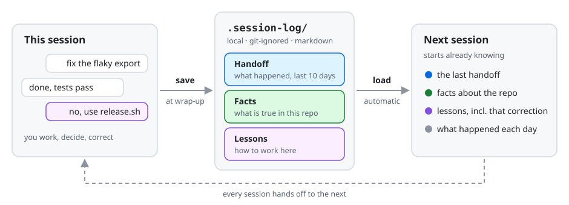

# Relay

**Memory for AI coding agents that lasts between sessions.** When a session ends,
Relay saves a handoff along with what the agent learned. The next session starts
already knowing both. It works in any repo, with Claude Code, Codex, Cursor,
OpenCode, and Grok Build.

<picture>
  <source media="(prefers-color-scheme: dark)" srcset="docs/img/session-loop-dark.svg">
  
</picture>

## Install

From the root of any repo:

```bash
curl -fsSL https://raw.githubusercontent.com/jeremybrice/relay/main/dist/install.sh | bash
```

It asks which CLIs to set up and only adds files. Nothing you already have gets
rewritten. Commit the new `.relay/` folder. Your handoffs stay local in
`.session-log/`, which is git-ignored.

To update, run the same line with `bash -s -- --detect`. For flags, per-CLI
wiring, and update notes, see the [reference](docs/reference.md#install).

## Use

| When | What to do |
|---|---|
| **Start** | Nothing to do. The last handoff and what Relay knows load on their own. |
| **Save** | Run `/session-save` when you wrap up (`$session-save` in Codex), or say you're done and the agent offers. |
| **Learn** | Run `/relay-learn` to capture a fact or lesson as soon as it comes up. |

When you save, the agent reads back your own messages since the last save, so a
correction you made hours ago can still become a lesson.

## Lessons become rules

<picture>
  <source media="(prefers-color-scheme: dark)" srcset="docs/img/lesson-lifecycle-dark.svg">
  
</picture>

A lesson has to come up on three different days before Relay suggests turning it
into a rule. You approve every rule before it's written.

## Who does what

<picture>
  <source media="(prefers-color-scheme: dark)" srcset="docs/img/division-of-labor-dark.svg">
  
</picture>

The agent decides what's worth keeping, and `relay.sh` does every write. That
split keeps the counters honest and lets the same core run under every CLI.

## What it isn't

- **No daemon.** Nothing runs in the background. Relay acts at session start and
  when you or the agent call it.
- **No cloud.** Everything stays as plain markdown in your repo.
- **No scoring math.** A lesson is ready once it has come up on three separate
  days.

---

[Reference](docs/reference.md) · [Design spec](docs/design-spec.md) ·
[Design walkthrough](docs/relay-learning-design.html)
