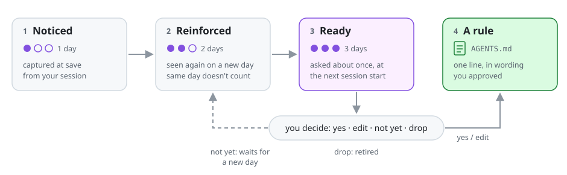
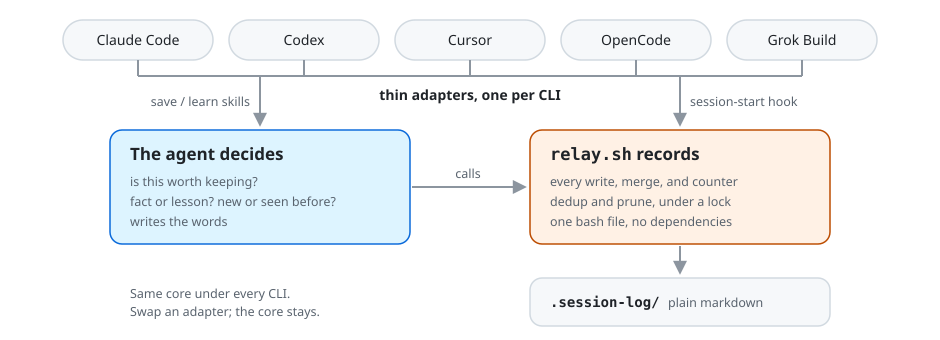

# Relay reference

The details behind the [README](../README.md).

- [Install](#install)
- [Update](#update)
- [Daily use](#daily-use)
- [Two tiers](#two-tiers)
- [Facts vs lessons](#facts-vs-lessons)
- [Lesson lifecycle](#lesson-lifecycle)
- [Commands](#commands)
- [Layout](#layout)
- [Design rules](#design-rules)
- [What it deliberately isn't](#what-it-deliberately-isnt)

## Install

From the root of the repo you want Relay in:

```bash
curl -fsSL https://raw.githubusercontent.com/jeremybrice/relay/main/dist/install.sh | bash
```

Pass flags after `bash -s --`:

```bash
curl -fsSL https://raw.githubusercontent.com/jeremybrice/relay/main/dist/install.sh | bash -s -- --clis claude,cursor   # no prompt
curl -fsSL https://raw.githubusercontent.com/jeremybrice/relay/main/dist/install.sh | bash -s -- --detect              # only CLIs already present
```

Or download it, read it, then run it:

```bash
curl -fsSLO https://raw.githubusercontent.com/jeremybrice/relay/main/dist/install.sh && bash install.sh
```

With a local clone of this repo, run the source installer instead (same flags):

```bash
bash ~/Documents/GitHub/relay/install.sh
```

The installer asks which CLIs to set up (Claude Code, Codex, OpenCode, Cursor,
Grok Build), with any already present in the repo pre-checked. Toggle by number,
`a` for all, Enter to finish. Without a terminal it falls back to `--detect`.

What it does:

- Lays down `.relay/` (the tool; commit it so it travels via git).
- Wires a session-start load plus save commands for each chosen CLI.
- Gitignores `.session-log/` (your handoffs and knowledge stay local).
- Appends one labeled block per CLI to `AGENTS.md` (Claude Code reads it too).

It is additive, idempotent, and reversible: nothing existing is rewritten.
Re-installing over an older install moves Claude Code's block out of `CLAUDE.md`
into `AGENTS.md`, leaving the rest of `CLAUDE.md` untouched.

Each block also tells the agent that the handoff and index are summaries: when
the task touches work from an earlier day, it should open that day's
`.session-log/history/<date>.md` before starting.

| CLI | Load at session start | Save / learn / compact |
|-----|-----------------------|------------------------|
| Claude Code | `SessionStart` hook in `.claude/settings.json` + `AGENTS.md` block | `.claude/skills/` → `/session-save`, `/relay-learn`, `/relay-compact` |
| Codex | `SessionStart` hook in `.codex/hooks.json` (run `/hooks` once to trust it) + `AGENTS.md` fallback | `.codex/skills/` → `$session-save`, `$relay-learn`, `$relay-compact` |
| OpenCode | `instructions` snapshot in `opencode.json` | `.opencode/commands/` → `/session-save`, `/relay-learn`, `/relay-compact` |
| Cursor | `AGENTS.md` block (reads `.session-log/latest.md` + `index.md`) | `.cursor/skills/` → `session-save`, `relay-learn`, `relay-compact` |
| Grok Build | `.grok/hooks/relay.json` (run `/hooks-trust` once) + `AGENTS.md` block | `.grok/skills/` → `session-save`, `relay-learn`, `relay-compact` |

Claude Code, Cursor, and Grok share one skill set (`adapters/skills/`). Every
install also ships `.relay/tests/smoke-compact.sh`, the contract test for
`knowledge compact` / `restore`.

## Update

There is no separate update command: re-run the installer with `--detect` from
the repo root. It replaces `.relay/relay.sh`, rewrites each CLI's `AGENTS.md`
block in place, and leaves `.session-log/` alone.

```bash
curl -fsSL https://raw.githubusercontent.com/jeremybrice/relay/main/dist/install.sh | bash -s -- --detect
# or, from a local clone (installs whatever branch the clone is on):
bash ~/Documents/GitHub/relay/install.sh --detect
```

Then commit the updated `.relay/` so other machines pick it up.

Update before the next save after the index switched to tables: an older
`relay.sh` keeps only the old one-line index entries and would drop the table
rows.

`.session-log/.relay-format` records the data layout. A `relay.sh` older than the
data refuses to write and tells you to update, instead of mangling the files.

## Daily use

- **Load** is automatic: the last handoff, active knowledge, and the index are
  injected at session start. Every knowledge entry is named by its id. The
  top-ranked entries appear in full under their own word budget (so knowledge
  can't crowd out the handoff), and the rest are listed by id
  (`relay knowledge why <id>` opens one), so nothing is silently dropped.
- **Ready to become rules**: on a fresh start (not after a compaction or a
  resume), up to 3 graduation-ready lessons appear above the handoff, and the
  agent asks you once about each before it starts work: yes, edit, not yet, or
  drop. Claude Code and Codex also show a one-line notice when any are ready.
- **Save** with `/session-save` (Claude Code) or `$session-save` (Codex), or the
  agent offers when you wrap up. One reflection routes into three destinations:
  the handoff, any new facts, and any new or reinforced lessons. Before writing,
  the agent runs `relay turns`, which reads your own turns since the last save
  back from the tool's transcript (Claude Code, Codex, Grok), so a correction
  made hours earlier, or before a compaction, can still become a lesson.
  Nothing from the transcript is stored.
- **Learn mid-session** with `/relay-learn` (`$relay-learn` on Codex) to capture
  a fact or lesson the moment it comes up.

## Two tiers

| Tier | What it holds | Answers | Lifespan |
| --- | --- | --- | --- |
| **1 · Ephemeral handoffs** | A 6-section handoff per session (Summary / Changed / Decisions / Next / Watch out / Open questions), a one-row-per-day index, a dated history file. | *"What happened recently?"* | Rolling 10-day window, then pruned. |
| **2 · Durable knowledge** | Facts and lessons captured at the same save moment. | *"What's permanently true, and what have I learned here?"* | Never pruned. |

## Facts vs lessons

The two kinds are not cosmetic: facts are *looked up*, lessons are *acted on* and
can harden into rules.

- **Facts** are reference truths about the repo (e.g. *"deploys ship via
  `scripts/release.sh`, never `npm publish`"*). They carry a `confirmed` counter
  and an optional `ttl` for freshness. On a divergent rewrite they raise a
  **conflict** rather than silently overwriting; you pick a side with
  `resolve --keep new|existing` (defaults to keeping the existing fact).
  Restating a fact in similar words updates it to the newest wording and keeps
  the previous version in `facts/superseded/`. Facts **never graduate**.
- **Lessons** are behavioral patterns (*when X, prefer Y, because Z*). They carry
  a `seen` count plus a `sessions` count of **distinct dates**. Lessons can
  graduate.

## Lesson lifecycle

<picture>
  <source media="(prefers-color-scheme: dark)" srcset="img/lesson-lifecycle-dark.svg">
  
</picture>

A lesson advances by a counter and a threshold, ending in a gated append. No
confidence math, no decay scheduler.

1. **Noticed**: captured at save (`sessions: 1`).
2. **Reinforced**: re-asserted on a *new day*. Same-day repeats don't count, so a
   coincidence seen three times in one afternoon can't pass for a pattern.
3. **Ready**: at `sessions ≥ 3` (configurable via `RELAY_GRADUATE_AT`). It is
   asked about at the next fresh session start, never at wrap-up.
4. **Graduated**: the agent proposes a one-line rule (240 characters max), you
   say yes or reword it, and the rule is written as an id-keyed block into
   `AGENTS.md` (or `CLAUDE.md`, if it already holds graduated rules) where the
   harness loads it natively, with a pointer to the full lesson
   (`relay knowledge why <id>`). This step is always gated: it's a persistent,
   behavior-changing edit to a file you may commit.

"Not yet" (`knowledge defer <id>`) hides a ready lesson until it is re-asserted
on a later day, so it only comes back with new evidence. "Drop" retires it with
`knowledge supersede <id>`. Skipping the question records nothing; it comes up
again next session.

A graduated rule that goes stale is drained with `knowledge ungraduate <id>`; a
wrong lesson or fact is retired with `knowledge supersede <id>`. Nothing is ever
silently orphaned.

## Commands

Every write is a `relay.sh` subcommand:

```bash
relay knowledge add --fact   --near "…"          # show matching ids, write nothing
relay knowledge add --fact   --id <slug> "…"     # create / confirm / or raise conflict
relay knowledge add --lesson --id <slug> "…"     # create / bump seen + sessions
relay knowledge add --fact --id <slug> - <<'EOF' # body on stdin (quote-safe)
relay knowledge graduate <id> --rule - <<'EOF'   # write a one-line rule for a ready
                                                 #   lesson into the instruction file (gated)
relay knowledge defer <id>                       # "not yet": wait for a later-day re-assertion
relay turns --harness auto|claude|codex|grok     # print your turns since the last save
                                                 #   (read-only; writes no transcript text)
```

`knowledge add` rejects unknown options and more than one body argument, so a
mistyped flag or an unquoted body can never be stored in place of the text.

Curation verbs round out the surface: `resolve --keep new|existing` (settle a
conflict), `supersede <id>` (retire an entry), `prune --yes` (retire stale
facts), `ungraduate <id>`, `why <id>` (show provenance), `list`, and `export`.

## Layout

```
.relay/              committed · the tool travels via git
  relay.sh           the deterministic core (load · save · knowledge …)
  adapters/          templates the installer wires from

.session-log/        git-ignored · local-only
  latest.md          newest single-session handoff
  index.md           table, one row per day, ≤ 10 days
  .relay-format      data layout version (an older relay.sh refuses to write)
  history/           one file per day, last 10 (older pruned)
  knowledge/         durable, never pruned
    index.md         derived cache, rebuilt from entry files every locked op
    facts/<id>.md    one file per fact   (+ superseded/ tombstones)
    lessons/<id>.md  one file per lesson (+ graduated/, superseded/)

AGENTS.md            gains a <!-- relay:learned --> block for graduated lessons
```

## Design rules

<picture>
  <source media="(prefers-color-scheme: dark)" srcset="img/division-of-labor-dark.svg">
  
</picture>

This split is Relay's core invariant and what keeps it portable:

- **`relay.sh` (the deterministic core)** owns every write, merge, dedup, counter
  bump, and prune, all under a portable `mkdir` lock. The agent never edits the
  data files directly, which is what makes the counters trustworthy and
  graduation idempotent.
- **The agent** owns judgment and prose: is this durable? does it match an
  existing lesson? what's the stable id? It authors; the helper records.
- **Adapters stay thin**: per harness they wire the trigger (a `SessionStart`
  hook), the context-injection field, and the thin save/learn commands, then call
  the same core. Swap an adapter without touching the core.
- **The data is just markdown**, fully readable with no adapter at all.

## What it deliberately isn't

Relay keeps the *idea* of a learning system (capture, reinforce, graduate) and
drops the machinery a dogfood repo won't have:

- No cron, background capture, or batch analyzer.
- No time-decay (no scheduler to run it). Staleness is handled by lazy TTL checks
  at load and by deliberate `supersede`.
- No confidence-score math, just the `seen`/`sessions` counter and a threshold.
- No committed/shared or cross-repo store yet (the config switch is reserved).
  The one thing that travels today is a *graduated* lesson, because the
  instruction file is yours to commit.
